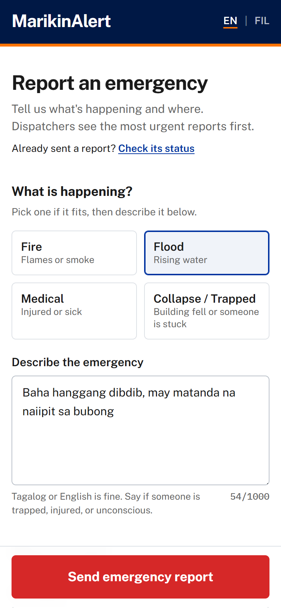
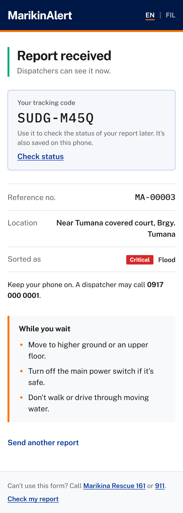
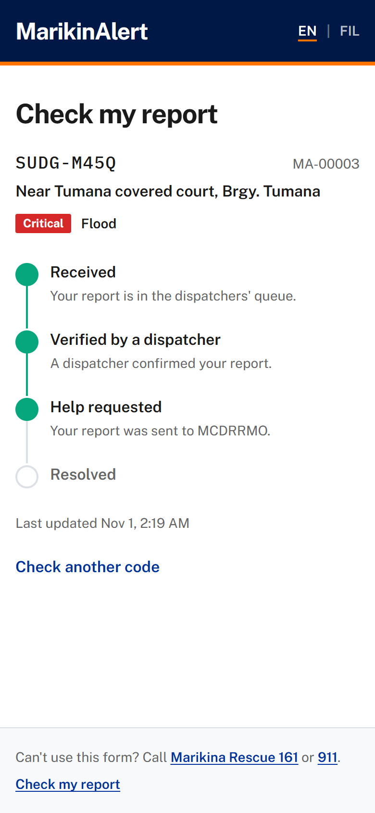
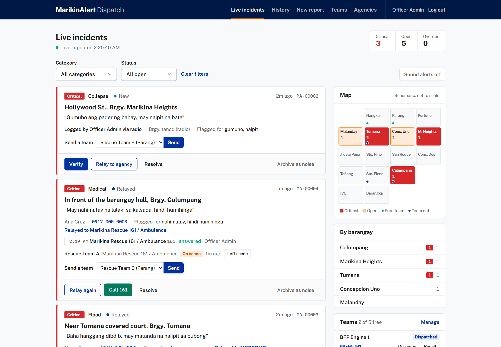
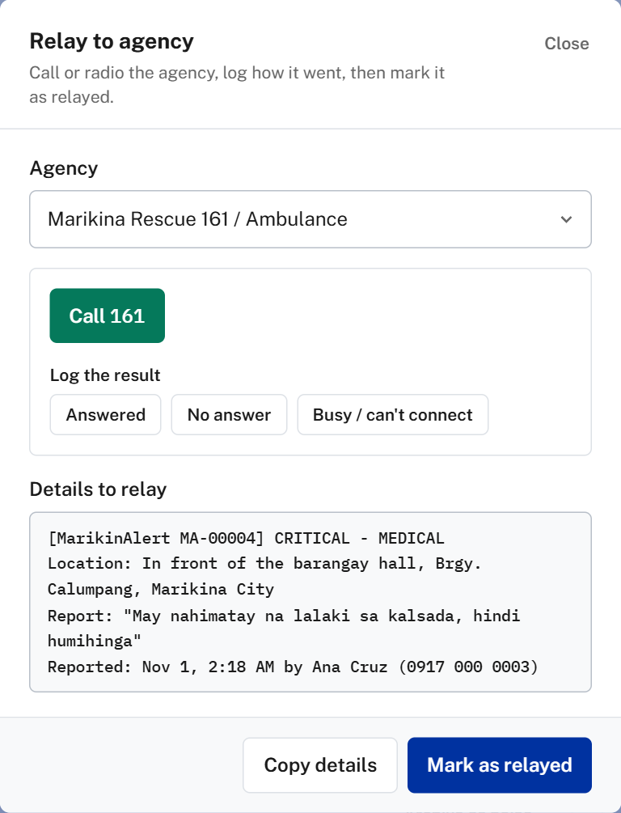
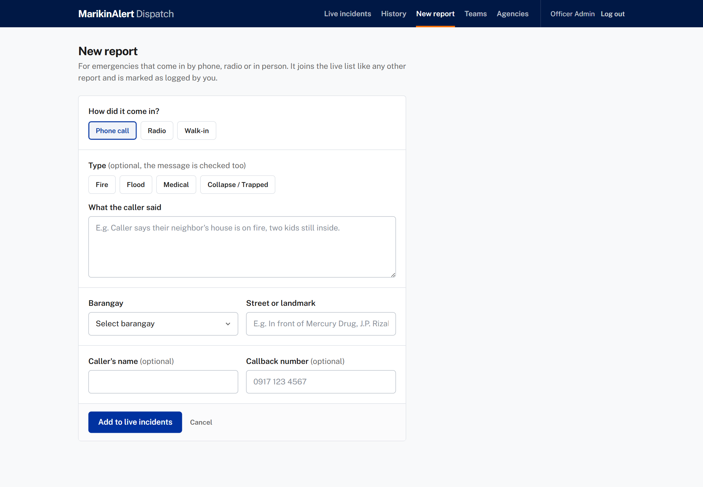
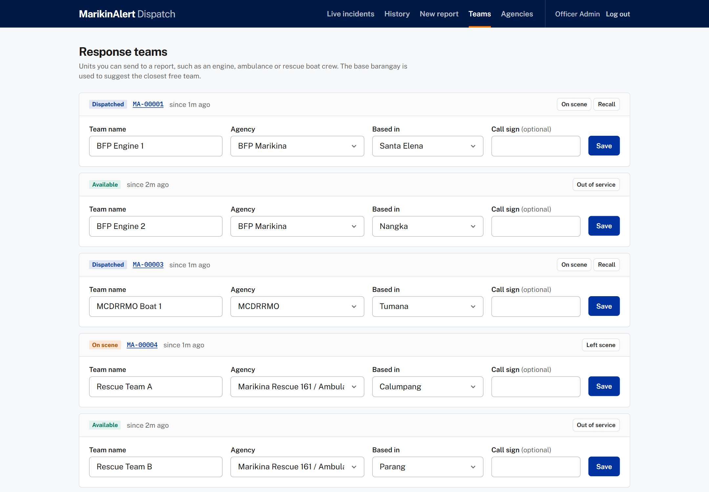

# MarikinAlert

A hyper-local disaster reporting and dispatch system for Marikina City that keeps working when the internet goes down.

Residents connect to a local public Wi-Fi node and send an emergency report in plain Taglish. An automated triage engine sorts each report by category and urgency, and dispatchers watch a live, color-coded dashboard where they verify reports and relay them to BFP, PNP, MCDRRMO and other response agencies.

> Research project for **Application Development and Emerging Technologies (COMP 019)**, Polytechnic University of the Philippines, College of Computer and Information Sciences. See [`docs/MarikinAlert.pdf`](docs/MarikinAlert.pdf) for the full proposal.

---

## Features

**For residents**
- **Works offline.** Every script, font and icon is served from the app itself, so it runs on a local intranet with no internet.
- **Nothing lost when the Wi-Fi drops.** A report that can't be sent is saved on the phone and sends itself once the connection is back, without creating duplicates (see [If the Wi-Fi drops](#if-the-wi-fi-drops)).
- **A three-step form built for panic:** what is happening → where you are → how to reach you (optional).
- **Quick-pick buttons** for Sunog / Baha / Medical / Gumuho-Naipit, plus a free-text Taglish message.
- **A barangay picker** with all 16 Marikina barangays, plus a street or landmark field.
- **A confirmation page** with a reference number, how the report was sorted, and safety tips for that kind of emergency.
- **Fallback hotlines** (Rescue 161 / 911) on every page.

**For dispatchers (Rescue Command)**
- **Login-protected admin portal** at `/Admin`.
- **Live dashboard** that refreshes every 5 seconds without reloading the page. Critical reports go to the top.
- **Color codes:** 🔴 Critical (immediate threat to life) · 🟡 High (fire, flood, injury) · ⚪ Normal.
- **Filters** by category and status, live critical and open counts, and an optional sound alert for new critical reports.
- **IsVerified protocol:** Verify → Relay to agency → Resolve, or Archive as noise.
- **Relay dialog** that suggests the right agency and lets you copy the report details for radio or phone.
- **Agency directory** (`/Admin/Agencies`) with hotlines, backup numbers and radio channels. A **Call** button on each report dials the agency from the dispatcher's phone (no internet needed), and every call is logged on the report: answered, no answer or busy.
- **Response teams** (`/Admin/Teams`). Send a free team to a report, with the right agency's closest team suggested first, and track it: Dispatched → On scene → Returning → Available.
- **Schematic barangay map** on the dashboard showing open and critical reports and where teams are based. Click a barangay to filter.
- **History page** with search and a Reopen button.
- **New report** page for emergencies that come in by phone call, radio or walk-in. The card shows "Logged by (dispatcher) via phone call", and the dispatcher gets a tracking code to give the caller.

---

## Demo

Screenshots use sample data:

### Resident (phone)

| Report form | Confirmation | Check my report |
|:---:|:---:|:---:|
|  |  |  |
| Pick a type, describe it in Tagalog or English, choose the barangay. | Tracking code, how the report was sorted, and what to do while waiting. | Enter the tracking code to see whether help is on the way. |

### Dispatcher (laptop)

**Live incidents.** Critical reports first, a barangay map of open reports and teams, and team status on each report.



| Relay and call an agency | Logging a phone or radio report |
|:---:|:---:|
|  |  |

**Response teams.** Each team's status and the report it's on.



---

## Tech stack

| Component | Technology |
|---|---|
| Framework | ASP.NET Core MVC (.NET 8.0) |
| Language | C# |
| Data access | Entity Framework Core 8 |
| Database | SQLite |
| Frontend | Razor Views, Tailwind CSS (Marikina theme), vanilla JavaScript (fetch/AJAX) |
| Fonts | Public Sans, IBM Plex Mono (bundled locally) |
| Architecture | Repository Pattern & Dependency Injection |
| Testing | NUnit |

---

## Getting started

### Prerequisites
- [.NET 8 SDK](https://dotnet.microsoft.com/download/dotnet/8.0). Check with `dotnet --list-sdks`.
- Git
- Visual Studio 2022 or VS Code (optional)

### Run it

```cmd
git clone https://github.com/controlbackspace/MarikinAlert.git
cd MarikinAlert\Frontend_MarikinaAlert
dotnet run
```

The SQLite database is created automatically the first time you run the app, at `Frontend_MarikinaAlert/App_Data/marikinalert.db`. You don't need any migration commands.

| Page | URL |
|---|---|
| Resident report form | http://localhost:5131 |
| Dispatcher login | http://localhost:5131/Admin |

### Admin login

| Username | Password |
|---|---|
| `admin` | `marikina123` |

You can change these in `Frontend_MarikinaAlert/appsettings.json` under `AdminAccount`.

### Let phones on the same Wi-Fi connect

```cmd
dotnet run --launch-profile lan
```

Then open `http://<this-laptop's-IP>:5131` on the phone. Run `ipconfig` to find the IP. If phones can't connect, allow port 5131 through Windows Firewall.

### If the Wi-Fi drops

Phones can lose the node mid-report: out of range, a busy access point, the laptop restarting.

- **Draft:** the form saves what the resident types on the phone as they type.
- **Outbox:** if sending fails, the report goes into an outbox on the phone and is retried every 15 seconds, when the phone comes back online, and when the page is reopened. A banner on every resident page says a report is waiting, then shows its tracking code once it's sent. The form also shows the 161 / 911 hotlines.
- **No duplicates:** each report carries a random id (`ClientRequestId`). If the server already has it (the first send got through but the reply was lost), it returns the same report instead of saving a second one.

The page itself still has to be open: residents can't load the form for the first time without a connection to the node. Making the page load with no connection would need a service worker, and browsers only allow those on HTTPS or `localhost`, not on `http://<laptop-IP>`. Serving the node over HTTPS with a certificate the phones trust would make that possible.

### Run the tests

```cmd
cd MarikinAlert
dotnet test
```

---

## How it works

```
Resident phone ──► Local Wi-Fi node ──► ReportsController.Create
                                             │
                                             ▼
                                  IDisasterTriageService      (Taglish keywords → Category + Priority)
                                             │
                                             ▼
                                  IReportRepository ──► SQLite
                                             │
                                             ▼
Dispatcher laptop ◄── AdminController.Feed (polled every 5s) ◄── open reports, most urgent first
```

1. **Ingestion:** a resident submits the form.
2. **Processing:** `KeywordTriageService` reads the raw message and matches Taglish keywords.
3. **Persistence:** the `DisasterReport` is saved through `IReportRepository`.
4. **Display:** the dashboard checks `/Admin/Feed` every 5 seconds, and new reports appear highlighted.

### Triage rules (summary)

| Category | Example keywords | Default priority |
|---|---|---|
| Fire | sunog, nasusunog, apoy, usok, fire, smoke | High |
| Collapse | gumuho, guho, nagiba, natabunan, collapse | Critical |
| Medical | patay, walang malay, hindi humihinga, nalunod, duguan | Critical |
| Medical | sugatan, aksidente, nabundol, injured | High |
| Flood | baha, bumabaha, umaapaw, lubog, flood | High |

Some phrases raise **any** report to **Critical**: *naipit / trapped*, *nalulunod / drowning*, *sa bubong / on the roof*, *may bata (pa) sa loob / people inside*. If no keyword matches, the app uses the resident's quick-pick button and sets the priority to High.

The matching ignores accents and capital letters, and it works on Tagalog word forms (for example, *sunog* also matches *nasusunog*). It also avoids common false matches: *bahay* (house) is not read as *baha* (flood).

---

## Project structure

```
MarikinAlert/
├── docs/
│   └── MarikinAlert.pdf            # Research proposal
├── Frontend_MarikinaAlert/         # ASP.NET Core MVC web app
│   ├── Controllers/
│   │   ├── ReportsController.cs    # Public report form + confirmation
│   │   ├── AdminController.cs      # Login, live dashboard, actions, history
│   │   └── HomeController.cs       # Error pages
│   ├── Data/AppDbContext.cs        # EF Core context (SQLite)
│   ├── Models/                     # DisasterReport, enums, view models, barangay list
│   ├── Repositories/               # IReportRepository + EF implementation
│   ├── Services/                   # IDisasterTriageService + Taglish keyword triage
│   ├── Views/
│   │   ├── Reports/                # Create (form), Submitted (confirmation)
│   │   ├── Admin/                  # Login, Dashboard, History, New report, incident card partials
│   │   └── Shared/                 # Resident + admin layouts, badges, error page
│   └── wwwroot/
│       ├── css/site.css
│       ├── js/site.js              # Report form behaviour
│       ├── js/admin.js             # Live polling, actions, relay dialog
│       └── lib/                    # Bundled offline assets (Tailwind, fonts, jQuery)
└── MarikinAlert.Tests/             # NUnit tests for the triage engine
```

---

## Report lifecycle

| Status | Meaning | Shown on |
|---|---|---|
| **New** (Active) | Just arrived, not yet reviewed | Dashboard |
| **Verified** | Dispatcher confirmed it is real | Dashboard |
| **Relayed** | Forwarded to an agency | Dashboard |
| **Resolved** | Incident closed | History |
| **Dismissed** | Archived as noise or a false alarm | History |

Reports in History can be **reopened** back to the dashboard.

---

## Known limitations / roadmap

- [ ] **Distributed node mirroring:** syncing reports between admin laptops (nodes). Right now each node has its own SQLite database.
- [ ] **Hashed admin credentials and multiple dispatcher accounts.** The current single account in `appsettings.json` is for demo use only.
- [ ] **A precompiled Tailwind stylesheet.** The bundled in-browser Tailwind works offline but isn't meant for production.
- [ ] **Load testing** for the 500–1,000 simultaneous reports target. SQLite runs in WAL mode so the dashboard can read while reports are being written.

---

## Team (BSCS 3-1N)

- Caasi, Vinjireh O.
- Dela Cruz, Andrei Steven D.
- Dela Paz, Bien Jeric
- Lamac, Jake Anthony A.

**Adviser:** Sir Eugene Andrew Bato
